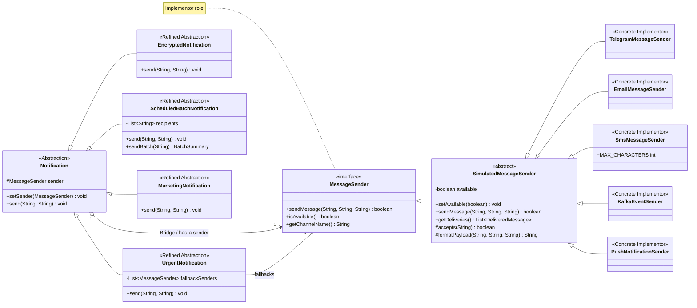

# Multi-Channel Notification Gateway

Assignment 3 for Software Design Patterns: a Java 17 console application that uses the **Bridge pattern** to separate notification behavior from delivery channels. All providers are simulated. No accounts, API keys, external messaging services, or paid infrastructure are needed.

## Build and run

Requirements: **JDK 17 or newer** and **Maven 3.9+**. Run these commands from the directory containing `pom.xml`:

```sh
mvn -B -ntp verify
java -jar target/notification-gateway-1.0.0.jar
```

Run just the tests with `mvn -B -ntp test`. The first build downloads Maven plugins and JUnit. Dependencies are cached in the ignored project-local `.m2/repository` directory. After the first successful build, `mvn -o test` runs the tests offline. The packaged application itself needs only Java and works offline.

For IntelliJ IDEA, open `pom.xml` as a Maven project, select JDK 17+, and run `kz.aitu.gateway.Demo`. The same tests can be run from the IDE.

## Mandatory demonstration

`Demo.main` executes every required scenario in order:

| No. | Scenario | Expected behavior |
| --- | --- | --- |
| 1 | Urgent + Telegram | A formatted message containing `[URGENT]` |
| 2 | Encrypted + Email | UTF-8 Base64 body, email subject, and signature |
| 3 | Scheduled batch + SMS | Three attempted recipients; total 3, successful 2, failed 1 |
| 4 | Runtime switch Telegram → Email | The same `urgent` object sends through both channels |
| 5 | Telegram unavailable → SMS | Availability check skips Telegram and delivers via fallback |
| 6 | Marketing + Push | Device alert containing a promotion and unsubscribe text |
| Extra | Encrypted + Kafka | Simulated event published to the `notifications` topic |

The blank recipient in scenario 3 is intentional: it demonstrates a failed delivery and accurate batch accounting. [Example output](docs/demo-output.txt) contains a captured run.

## Architecture and UML



`Notification` is abstract; each refined abstraction implements `send`. `MessageSender` is the Implementor interface. `SimulatedMessageSender` shares validation, availability, logging, and an in-memory delivery history; it is an implementation detail on the sender side, not the Bridge itself. Each concrete sender supplies its channel name and formatting. The aggregation arrow means that a notification holds a sender reference; sender instances may be shared and can outlive the notification.

### What are the two independent dimensions?

The first is **notification policy**: urgent delivery, message encoding, batch delivery, and marketing content. The second is **delivery implementation**: Telegram, email, SMS, Kafka, and push. A notification controls what is sent and when to use fallback; a sender controls channel restrictions and output formatting.

### Where exactly is the Bridge?

It is the `protected MessageSender sender` field in `Notification`, initialized by constructor injection and replaced by `setSender`. Refined abstractions delegate delivery to `sender.sendMessage(...)` through the interface. They do not import concrete provider classes or use `instanceof` checks.

### Why is inheritance problematic here?

A combined inheritance hierarchy would need classes such as `UrgentTelegramNotification`, `UrgentEmailNotification`, and `EncryptedSmsNotification`. With N notification types and M channels this can grow to N × M combination classes. Bridge needs N notification types and M sender implementations, plus their shared abstractions; combinations are assembled from objects at runtime.

### What happens when a new provider is added?

Implement `MessageSender`, or extend the optional simulator base class, and inject the new provider into an existing notification. `PushNotificationSender` was added after the core implementation. No existing notification class changed. The extension tests use Push with urgent, encrypted, and batch notifications.

### What happens when a new Notification type is added?

Extend `Notification` and use its `MessageSender` field. `MarketingNotification` was added after the core implementation; no existing sender changed. A parameterized test verifies marketing delivery through all five channels. The Git history separates the initial implementation from this extension; only the demo wiring and new classes/tests were added in the extension commit.

### Why is this Bridge rather than Adapter?

Bridge intentionally separates two independently evolving dimensions from the beginning. Adapter converts an existing incompatible interface into one expected by a client. There is no incompatible external API to wrap here: all simulated channels implement the same contract by design. In a real system, a concrete sender could internally adapt a vendor SDK while still participating in this Bridge.

## Delivery rules and scope

| Component | Behavior |
| --- | --- |
| Telegram | Simulates Markdown formatting with a bold title |
| Email | Adds a subject and gateway signature |
| SMS | Sends only the body; rejects bodies longer than 160 Unicode code points without truncation |
| Kafka | Logs a topic, recipient key, and readable event payload |
| Push | Logs the target device and an alert title/body |
| Urgent | Prepends `[URGENT]`, checks availability, then tries fallbacks in order until one succeeds |
| Encrypted | Encodes the original UTF-8 message using Base64 before passing it to the sender |
| Scheduled batch | Copies the recipients at construction; `sendBatch` delivers to every entry and returns/prints a fresh summary |
| Marketing | Adds `[PROMO]`, a subject, and unsubscribe text |

All providers return `false` for an unavailable channel, null/blank recipient, null title, or null/blank body. Successful messages are retained in an immutable snapshot returned by `getDeliveries()`. Recipient identifiers are opaque so the demo can switch the same recipient between simulated channels.

Urgent fallback also handles an available sender returning `false`; it stops after the first success. No fallback configured, or all fallbacks failing, produces `Result: failed`. The sender contract reports expected delivery failures through `boolean`, not exceptions. Invalid configuration such as a null sender throws immediately.

`ScheduledBatchNotification.send(recipient, message)` honors the base single-recipient contract. `sendBatch(message)` explicitly executes the stored recipient collection. Each entry is an attempt, including duplicate/invalid entries, and every run resets its counts. “Scheduled” here means a prepared batch invoked at the desired time by the caller; this assignment requires batching, not a wall-clock scheduler or background service.

Base64 is reversible encoding, **not secure encryption**. SMS uses the assignment's simple character limit, not GSM/UCS-2 segmentation. Prefixes and footers count toward the SMS body limit. Kafka output is a simulation, not a real broker event or a JSON protocol. The marketing footer is text, not a subscription-management service. Everything runs synchronously in one thread.

## Tests

The JUnit 5 suite contains **34 test executions** (including five parameterized channel cases). It covers successful delivery, unavailable and recovered providers, ordered interface-only fallback, failed primary delivery, exhausted fallbacks, SMS boundaries and Unicode, transformed encrypted content, mixed/empty/unavailable/repeated batches, runtime switching, Kafka formatting, Push compatibility, Marketing compatibility, invalid inputs, and null-sender rejection.

Tests inspect recorded messages and returned summaries, rather than only checking console text. Test doubles implement `MessageSender` directly, proving that fallback does not require the simulator base class. Surefire writes results to `target/surefire-reports/`. GitHub Actions builds, tests, and runs the demo on Java 17 and 21.

## Files and defense

```text
src/main/java/kz/aitu/gateway/
  Demo.java                   mandatory scenarios
  notification/               Abstraction and refined abstractions
  sender/                     Implementor and concrete implementations
src/test/java/kz/aitu/gateway/ JUnit 5 tests
docs/DEFENSE_RU.md             explanation and modification practice
docs/demo-output.txt           captured console demonstration
.github/workflows/java.yml    continuous integration
pom.xml                       Java 17 / JUnit 5 / executable JAR
```

For the individual defense, use the [Russian walkthrough](docs/DEFENSE_RU.md). Submit the GitHub repository URL through Moodle; the UML and required design answers are included in this README.
